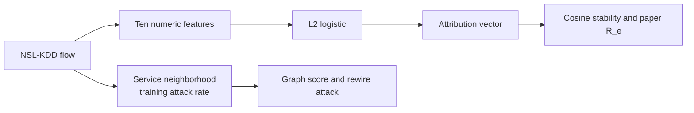

# Architecture

Attention is a softmax over feature dot products inside the service neighborhood. The classifier uses the flow, the pooled neighbor features, and the pooled training label. The service rate and the numeric logistic are the baselines.
