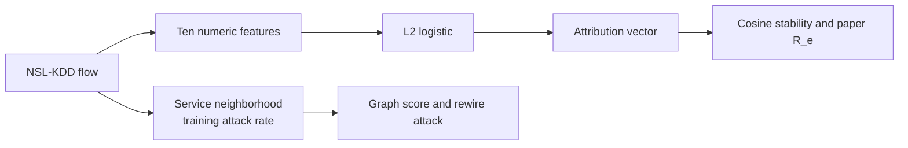

# Architecture

Layers in the concept paper that are not in this repository: stakeholder-specific views, an audit log of analyst overrides, and a human timing study. They are not filled with placeholder scores.
